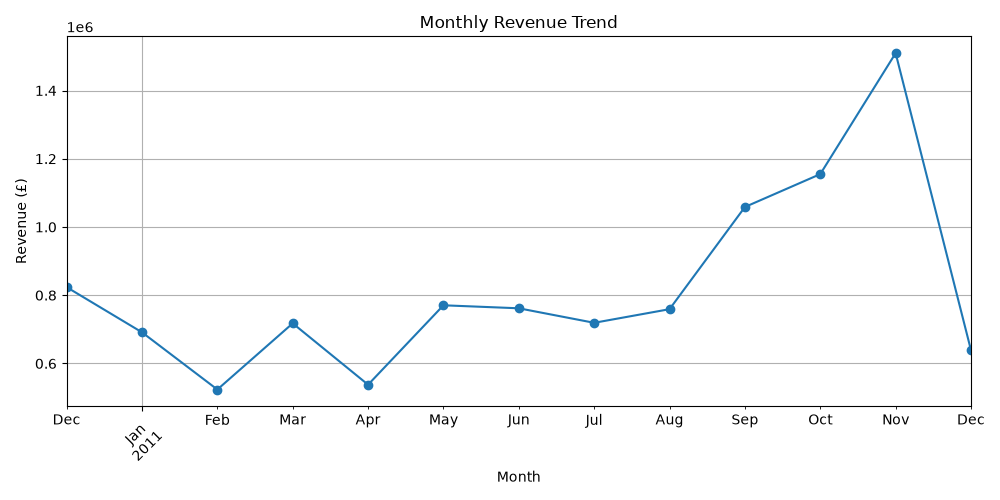
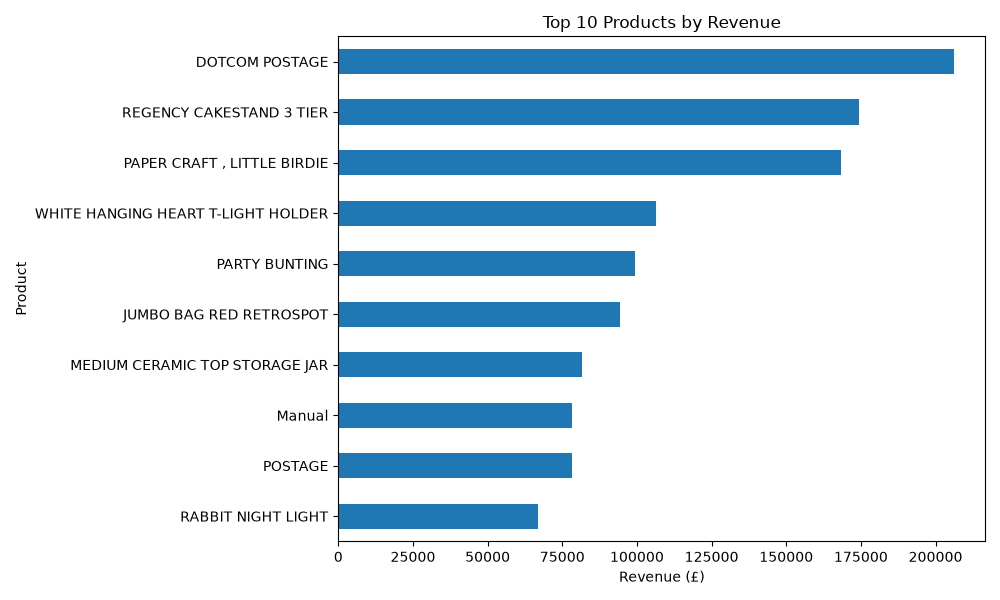
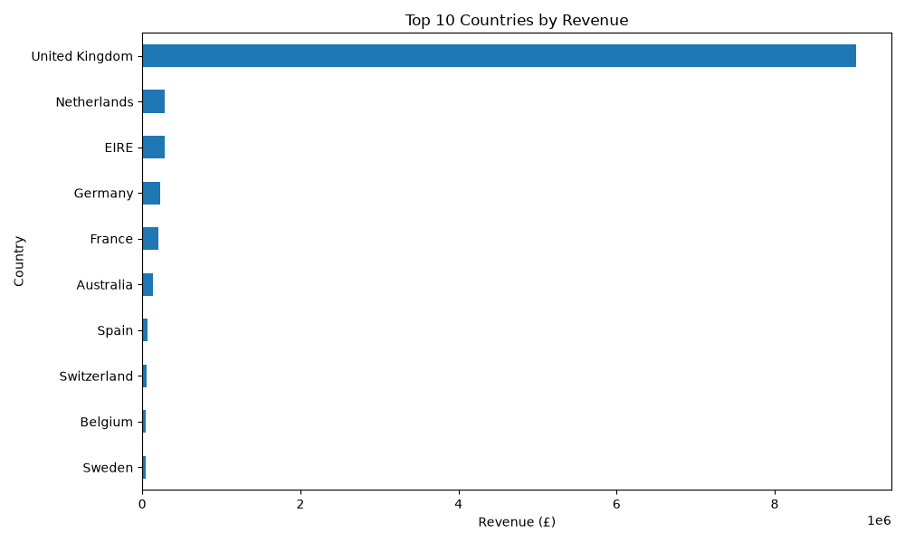
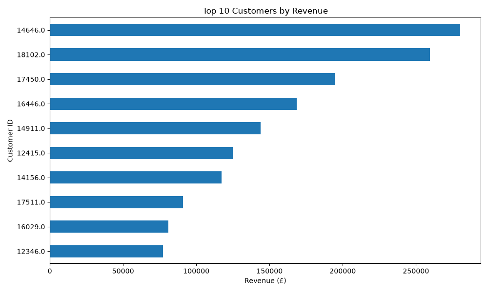

# Online Retail Data Analysis

## Project Overview

This project analyzes real-world online retail transaction data to identify sales trends, customer behavior, product performance, and country-wise sales patterns.

The analysis is performed using Python, Pandas, NumPy, and Matplotlib.
## Dataset

The project uses the UCI Online Retail dataset, which contains transaction records from a UK-based online retailer between December 2010 and December 2011.

The dataset contains information about invoices, products, quantities, prices, customers, dates, and countries.

## Tools & Technologies

- Python
- Pandas
- NumPy
- Matplotlib
- Jupyter/VS Code
- GitHub
## Data Cleaning & Preparation

The following steps were performed during data cleaning:

- Removed duplicate transaction records.
- Identified missing values in the dataset.
- Kept transactions with missing Customer IDs for overall sales analysis.
- Excluded cancellation invoices from normal sales analysis.
- Removed accounting adjustment records with negative unit prices.
- Removed non-product entries such as postage and manual transactions from product-level analysis.
- Removed non-positive quantity records from the final sales dataset.
- Calculated Revenue using:

  Revenue = Quantity × UnitPrice

- Converted InvoiceDate into a proper datetime format.
- Created a Month column for monthly sales analysis.
## Key Business Insights

### 1. Monthly Revenue
Revenue increased considerably during September to November 2011. November 2011 recorded the highest monthly revenue of approximately £1.51 million, while February 2011 recorded the lowest at approximately £0.52 million.

### 2. Product Performance
The highest-revenue product was `REGENCY CAKESTAND 3 TIER`, generating approximately £174,485 in revenue.

The product with the highest quantity sold was `PAPER CRAFT , LITTLE BIRDIE`, with 80,995 units sold.

### 3. Country-wise Revenue
The United Kingdom generated the highest revenue, approximately £9.03 million, followed by the Netherlands and EIRE.

### 4. Customer Behavior
A total of 4,339 customers had identifiable Customer IDs. Among them, 2,845 were repeat customers and 1,494 were one-time customers.

### 5. Average Order Value
The average order value was approximately £514.65.

### 6. Cancelled Invoices
The dataset contained 3,836 cancelled invoices, representing approximately 277,574 cancelled units.
## Visualizations

### Monthly Revenue Trend

### Top 10 Products by Revenue

### Top 10 Countries by Revenue

### Top 10 Customers by Revenue

## Conclusion

This project demonstrates how real-world retail transaction data can be cleaned, analyzed, and visualized to identify meaningful sales and customer patterns.

The analysis helped identify monthly revenue trends, high-performing products, major markets, customer purchasing behavior, average order value, and cancellation patterns.

These findings can help businesses understand their sales performance and customer behavior and support data-driven decision-making.

## Project Structure

Online-Retail-Data-Analysis/
│
├── Data/
│   └── online+retail/
│       └── online_retail.xlsx
│
├── analysis.py
├── monthly_revenue.png
├── top_10_products_revenue.png
├── top_10_countries_revenue.png
├── top_10_customers_revenue.png
└── README.md

## Dataset Source

The dataset used in this project is the UCI Online Retail dataset.

Source: UCI Machine Learning Repository

Dataset License: CC BY 4.0